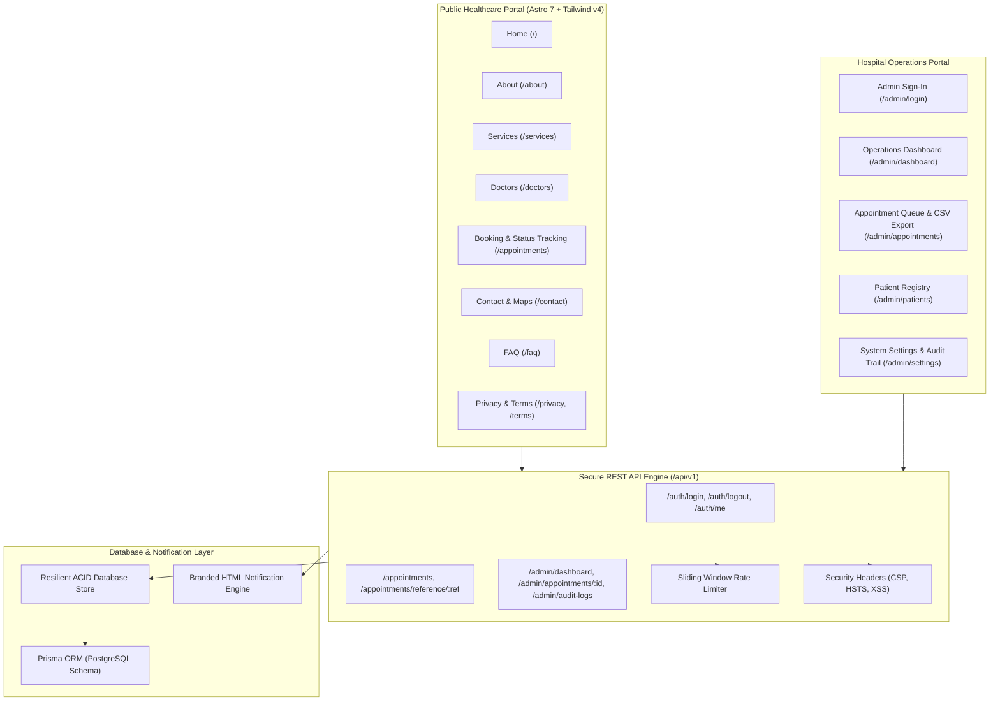

# Welfare Hospital, Agra — Full-Stack Healthcare Digital Platform

[](https://welfare-hospital-website.vercel.app/)
[](https://github.com/AshivamTechnologies/welfare-hospital)
[](https://astro.build)
[](https://tailwindcss.com)
[](https://www.typescriptlang.org)
[](#)

A complete, production-grade, full-stack healthcare digital platform engineered for **Welfare Hospital, Agra, Uttar Pradesh**. Designed for institutional credibility, patient trust, high-conversion appointment bookings, and administrative operations.

---

## 1. Verified Clinical Master Profile

| Parameter | Clinical / Operational Detail |
| :--- | :--- |
| **Hospital Name** | **Welfare Hospital** |
| **Supervising Physician & Owner** | **Dr. Opee Rajput** |
| **Primary Telephone** | **+91 8490068558** (Direct phone dialer integrated across all CTAs) |
| **Physical Address** | **100 Feet Road, Ram Bagh, Agra, Uttar Pradesh, India** |
| **Established Practice** | **34 Years** of continuous healthcare service |
| **Clinical Scope** | General Hospital, Physician Consultations, Preventive Health, Continuing Care |
| **Consultation Hours** | Monday – Saturday: Morning (10:00 AM – 1:00 PM) & Evening (5:00 PM – 8:00 PM) |
| **Live Production Platform** | **https://welfare-hospital-website.vercel.app/** |
| **Official GitHub Repository** | **https://github.com/AshivamTechnologies/welfare-hospital** |

---

## 2. Full-Stack System Architecture



---

## 3. Key Public Pages

1. **Homepage (`/`):** High-impact editorial hero section with 3D perspective doctor card, 34-year legacy metrics, trust pillars, services summary, and direct CTAs.
2. **About Hospital (`/about`):** Detailed history of Welfare Hospital in Ram Bagh, clinical standards, and community dedication.
3. **Medical Services (`/services`):** Full clinical service directory (Primary Healthcare, Physician Consultations, Health Checks, Continuing Care) with direct pre-selected booking links.
4. **Doctors & Medical Team (`/doctors`):** Profile for Dr. Opee Rajput and Allied Care specialists with verified OPD hours.
5. **Appointments & Live Status Tracker (`/appointments`):** Interactive booking form with Indian mobile validation (`^[6-9]\d{9}$`) plus a real-time status tracker querying reference codes (`WFH-AGRA-XXXX`).
6. **Contact & Location (`/contact`):** Address on 100 Feet Road, Ram Bagh, OPD schedule, tap-to-call links, and Google Maps query deeplinks.
7. **FAQ (`/faq`):** Accessible CSS-grid accordion answering patient questions regarding booking, fees, walk-ins, and doctor timings.
8. **Privacy Policy (`/privacy`):** Indian Digital Personal Data Protection (DPDP) Act 2023 compliant policy outlining patient consent, retention, and non-disclosure of medical records.
9. **Terms & Conditions (`/terms`):** Terms of service, emergency advisories, and outpatient conditions.

---

## 4. Hospital Admin Operations Portal

The portal is segregated under `/admin/` and protected by salted bcrypt password hashing and HTTP-only JWT cookies:

- **/admin/login:** Administrative sign-in with progressive brute-force rate limiting (5 attempts / 15 minutes) and security audit logs.
- **/admin/dashboard:** Real-time KPI summary (Total, Pending, Confirmed, Cancelled, Scheduled Today), recent inbound request queue, and quick actions.
- **/admin/appointments:** Paginated, searchable, filterable data table with status transition modal (`CONFIRMED`, `RESCHEDULED`, `COMPLETED`, `CANCELLED`, `REJECTED`), administrative notes editor, and one-click CSV export.
- **/admin/patients:** Outpatient directory with contact information and registration history.
- **/admin/settings:** Hospital master profile, verified OPD hours, and immutable security audit logs.

> **Default Super Admin Seed:**
> - Email: `admin@welfarehospital.com`
> - Password: `WelfareHospital@2026`

---

## 5. Security & Privacy Architecture

- **OWASP Compliant Headers:** Strict CSP, HSTS, `X-Content-Type-Options: nosniff`, `X-Frame-Options: DENY`, `Referrer-Policy: strict-origin-when-cross-origin`.
- **Masked Public Lookups:** Public reference lookup masks patient names (`S***a K***r`) and phone numbers (`98******10`) to prevent unauthorized personal data exposure.
- **Input Sanitization & Validation:** Strict Zod schema validation across all API endpoints.
- **Rate Limiting:** Sliding-window rate limiting protecting public appointment forms and admin authentication.
- **Audit Logging:** Every login event, status transition, and appointment creation is recorded with timestamps, user IDs, and client IP addresses.

---

## 6. Automated Testing & Verification

The test suite runs with **Vitest**:

```powershell
npm test
```

### Test Coverage:
- `tests/unit/validation.test.ts`: Indian mobile number regex, required fields, future-date checks, login schemas.
- `tests/unit/auth.test.ts`: Bcrypt password hashing/verification and JWT signing/verification.
- `tests/integration/appointments.test.ts`: Full end-to-end appointment creation, unique reference code generation, status transitions, and public masked lookup.
- `tests/security/rateLimit.test.ts`: Sliding-window threshold enforcement and blocking.

---

## 7. Local Development & Deployment

### Local Development:
```powershell
# Install dependencies
npm install

# Run automated tests
npm test

# Start Astro development server
npm run dev
```

### Production Build:
```powershell
# Build application with Vercel serverless adapter
npm run build
```

### Production Deployment:
```powershell
# Deploy to Vercel production
npx vercel --prod --yes
```

---

## 8. Git Repository Information

- **Company Repository:** `https://github.com/AshivamTechnologies/welfare-hospital.git`
- **Branch:** `main`
- **CI/CD:** `.github/workflows/ci.yml` (Automated testing, linting, and build verification on push to `main`).
